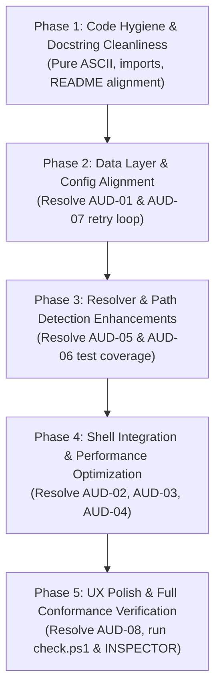

# Waypoint — Codebase Audit & Sequential Refactoring Plan

**Date:** 2026-10-09  
**Status:** Ready for Execution  
**Target Branch:** `dev`  

---

## 1. Executive Summary & Audit Overview

Waypoint is a lightweight, high-performance path-bookmark CLI designed for Windows PowerShell environments. It couples Python CLI logic with a PowerShell profile wrapper (`install.ps1`) to provide seamless `cd` navigation, history tracking, and bookmark management.

The test suite consists of 296 unit/integration tests with 98% line coverage. The codebase enforces strict type annotations (`mypy --strict`), styling rules (`ruff`), ASCII-only output for Windows CP1252 compatibility, and rich CLI presentation (`rich`).

However, an exhaustive audit across the codebase revealed several architectural inconsistencies, performance bottlenecks in shell hooks, documentation dissonances, and subtle edge-case bugs.

### Summary of Audit Findings by Severity

| Category | Finding ID | Severity | Description |
|---|---|---|---|
| **Data Layer & Config** | `AUD-01` | **High** | Default storage dissonance: comments/messages say "project dir", but resolution defaults to `~/.waypoint`. |
| **Shell Integration** | `AUD-02` | **High** | `Set-WaypointLocation` launches Python twice on every `cd` change, adding ~200ms latency to shell navigation. |
| **Shell Integration** | `AUD-03` | **Medium** | Missing `try { ... } finally` block in wrapper's standard branch leaves `WP_FORCE_COLOR` set on abort. |
| **Shell Integration** | `AUD-04` | **Medium** | `$KnownProfiles` in `install.ps1` misses OneDrive-redirected Documents folders. |
| **Parsing & Resolver** | `AUD-05` | **Medium** | `looks_like_path()` misses `..` and bare drive letters (`D:`), misinterpreting them as bookmark aliases. |
| **Documentation** | `AUD-06` | **Medium** | `wp mv` is omitted from `README.md`'s command summary and line 128 reserved keyword list. |
| **File I/O & Reliability** | `AUD-07` | **Low** | `_atomic_write` lacks retry logic for transient Windows file-locking collisions (`WinError 32`). |
| **Output & UX** | `AUD-08` | **Low** | `_row_style` completely dims missing bookmarks, hiding default status and current-directory matches. |
| **Code Hygiene** | `AUD-09` | **Low** | Non-ASCII characters (`U+2014`) present in `cli.py` docstrings/comments; imports inside function bodies in `store.py`. |
| **Test Coverage** | `AUD-10` | **Low** | Missing test coverage for `mv` and `store` in `test_validate_alias_rejects`. |

---

## 2. In-Depth Audit Findings

### 2.1. Data Layer & Configuration Precedence (`AUD-01`)
- **Location:** `waypoint/store.py`, `waypoint/commands/config.py`, `config.yaml`, `README.md`
- **Issue:**
  - `store.data_dir()` resolves `home: null` to `Path.home() / ".waypoint"`.
  - `README.md` lines 173–183 document `home: null # null = default (~/.waypoint)`.
  - However, `config.yaml` line 1 says: `# Where waypoint.yaml lives. Default: same dir as this config.`
  - `store.save_config_home` docstring says: `None resets to the documented default (home: null = project dir).`
  - `_config()` and `_store()` print: `ok(console, "Home set to default (project dir)")`.
- **Impact:** Misleading output and developer confusion. When users run `wp config home null`, the CLI claims storage is in the project directory, while actually pointing to `~/.waypoint`.
- **Remediation:** Align messages, comments, and docstrings with the actual behavior: `~/.waypoint` is the default.

### 2.2. Shell History Hook Performance (`AUD-02`)
- **Location:** `install.ps1`, `waypoint/resolver.py`, `waypoint/commands/history.py`
- **Issue:**
  - On every `cd`, `chdir`, `cd..`, `cd~`, `cd\`, the wrapper executes:
    ```powershell
    & python "$RepoDir\waypoint\__main__.py" _record_history $before > $null 2>&1
    & python "$RepoDir\waypoint\__main__.py" _record_history $current > $null 2>&1
    ```
  - Spawning two separate Python processes on Windows adds 150–300ms of lag per directory change.
- **Impact:** Sluggish terminal navigation across all shell operations.
- **Remediation:** Update `_record_history` to accept multiple paths (e.g. `_record_history $before $current`), reducing Python launches from two to one.

### 2.3. Environment Variable Leak on Wrapper Abort (`AUD-03`)
- **Location:** `install.ps1`
- **Issue:**
  - In `wp()`, the standard capture branch runs:
    ```powershell
    $lines = @(& python "$RepoDir\waypoint\__main__.py" @args)
    Remove-Item Env:WP_FORCE_COLOR -ErrorAction SilentlyContinue
    ```
  - If the user interrupts the command (Ctrl+C) or an unhandled pipeline error occurs, `WP_FORCE_COLOR` remains `1` in the session.
- **Remediation:** Wrap the execution in a `try { ... } finally { Remove-Item Env:WP_FORCE_COLOR ... }` block, matching the `-F` live branch.

### 2.4. Profile Detection with OneDrive Redirection (`AUD-04`)
- **Location:** `install.ps1`
- **Issue:**
  - `$KnownProfiles` hardcodes `"$HOME\Documents\..."`.
  - On systems where Known Folder Redirection is enabled (OneDrive), the Documents folder is at `"$HOME\OneDrive\Documents"`, causing `install.ps1` to miss existing profile blocks.
- **Remediation:** Include `[Environment]::GetFolderPath('MyDocuments')` in profile search candidates.

### 2.5. Relative Path Detection in Resolver (`AUD-05`)
- **Location:** `waypoint/resolver.py`
- **Issue:**
  - `looks_like_path(arg)` checks `arg == "~" or any(sep in arg for sep in ("\\", "/"))`.
  - Arguments such as `..` or `D:` return `False`.
  - Running `wp default ..` or `wp set ..` treats `..` as a bookmark alias instead of the parent directory.
- **Remediation:** Expand `looks_like_path(arg)` to recognize `..`, `.`, and Windows drive patterns (`^[a-zA-Z]:$`).

### 2.6. Documentation and Reserved Keyword Omissions (`AUD-06`)
- **Location:** `README.md`, `tests/test_resolver.py`
- **Issue:**
  - `wp mv <alias> <new_path>` is implemented and tested, but omitted from `README.md`'s primary "Manage bookmarks" command summary and line 128's reserved keywords list.
  - `test_validate_alias_rejects` in `tests/test_resolver.py` does not include `mv` or `store` in its parametrize cases.
- **Remediation:** Update `README.md` and test fixtures.

### 2.7. Atomic File Writes & Windows File Locks (`AUD-07`)
- **Location:** `waypoint/store.py`
- **Issue:**
  - `_atomic_write` uses `tempfile.mkstemp` and `os.replace`.
  - Under aggressive Windows background indexing or antivirus scanning, `os.replace` can occasionally encounter transient `PermissionError` (WinError 32).
  - Also, `import tempfile` is deferred inside the function rather than imported at top level.
- **Remediation:** Move `tempfile` to top-level imports and add a short retry backoff loop for transient Windows file-lock errors.

### 2.8. Bookmark List (`wp ls`) Dead-Row Styling (`AUD-08`)
- **Location:** `waypoint/commands/bookmarks.py`
- **Issue:**
  - `_row_style()` returns `"dim"` whenever `not is_alive`.
  - This hides whether a missing bookmark was the active default or matches the current working directory.
- **Remediation:** Allow default and cwd highlights to combine with dim or indicator styling for dead bookmarks.

### 2.9. Code Hygiene & ASCII Consistency (`AUD-09`)
- **Location:** `waypoint/cli.py`
- **Issue:**
  - `waypoint/cli.py` contains `\u2014` (em dash) on lines 5, 61, and 64 in docstrings and comments.
- **Remediation:** Replace with ASCII dashes `--` to ensure 100% pure ASCII across the entire `waypoint` module.

---

## 3. Sequential Refactoring Implementation Plan

The refactoring is structured into **5 sequential phases**. Each phase must pass all quality checks (`python -m ruff check .`, `python -m mypy waypoint`, `python -m pytest -q`) before proceeding to the next.



---

### Phase 1: Code Hygiene, Top-Level Imports & Documentation Alignment
- **Goals:**
  - Ensure 100% pure ASCII compliance across all `.py` files.
  - Move local `import tempfile` to top level in `store.py`.
  - Add `wp mv` to `README.md` command overview and line 128 reserved list.
  - Fix contradictory `config.yaml` comments and docstrings regarding default storage.
- **Tasks:**
  1. Replace em dashes (`\u2014`) in `waypoint/cli.py` with `--`.
  2. Clean up imports in `waypoint/store.py` (`import tempfile` at module level).
  3. Update `README.md` to document `wp mv <alias> <new_path>` under "Manage bookmarks" and include `mv` in the reserved keywords list.
  4. Fix comments in `config.yaml` to specify default is `~/.waypoint`.
- **Verification:**
  - `python -m ruff check .`
  - `python -m mypy waypoint`
  - `pytest`

---

### Phase 2: Data Layer & Config Message Alignment
- **Goals:**
  - Fix misleading "Home set to default (project dir)" messages in `_config` and `_store`.
  - Add Windows file-locking retry resilience in `_atomic_write`.
- **Tasks:**
  1. In `waypoint/commands/config.py`:
     - Update output for `null` target: `"Home reset to default (~/.waypoint)"`.
     - Update `_store` output for `null`: `"Store home reset to default (~/.waypoint)"`.
  2. In `waypoint/store.py`:
     - Add retry helper in `_atomic_write` (3 retries with 10ms exponential backoff on `PermissionError`).
     - Update docstring of `save_config_home` to correctly state `~/.waypoint` default.
  3. Update relevant test assertions in `tests/test_cli.py` and `tests/test_store.py`.
- **Verification:**
  - `pytest tests/test_store.py tests/test_cli.py`

---

### Phase 3: Resolver & Path Detection Enhancements
- **Goals:**
  - Fix relative path parsing (`..`, drive roots) in `looks_like_path()`.
  - Ensure `test_validate_alias_rejects` covers `mv` and `store`.
- **Tasks:**
  1. In `waypoint/resolver.py`:
     - Update `looks_like_path(arg)`:
       ```python
       def looks_like_path(arg: str) -> bool:
           return (
               arg in ("~", ".", "..")
               or any(sep in arg for sep in ("\\", "/"))
               or (len(arg) == 2 and arg[1] == ":" and arg[0].isalpha())
           )
       ```
  2. In `tests/test_resolver.py`:
     - Add `mv` and `store` to `test_validate_alias_rejects`.
     - Add tests for `looks_like_path("..")`, `looks_like_path("C:")`, `wp default ..`, `wp set ..`.
- **Verification:**
  - `pytest tests/test_resolver.py tests/test_bookmark_commands.py`

---

### Phase 4: Shell Integration & Performance Optimization
- **Goals:**
  - Optimize `_record_history` to accept multiple path arguments.
  - Reduce PowerShell `Set-WaypointLocation` overhead by 50% (1 Python process instead of 2).
  - Add `try { ... } finally { ... }` around `WP_FORCE_COLOR` cleanup in `install.ps1`.
  - Support OneDrive-redirected Documents in `install.ps1`.
- **Tasks:**
  1. In `waypoint/resolver.py`:
     - Update `RecordHistoryCmd` to hold `origins: list[str]`.
     - Update `parse_args` to accept 1 or more origins for `_record_history`.
  2. In `waypoint/commands/history.py`:
     - Update `_record_history_entry` to iterate and deduplicate list of origins.
  3. In `install.ps1`:
     - Combine the two `python ... _record_history` calls into:
       `& python "$RepoDir\waypoint\__main__.py" _record_history $before $current > $null 2>&1`
     - Add `try/finally` around `$lines = @(...)` in `function global:wp`.
     - Add `[Environment]::GetFolderPath('MyDocuments')` to `$KnownProfiles`.
  4. In `tests/test_wrapper_contract.py`:
     - Update contract tests asserting `_record_history` calls and wrapper behavior.
- **Verification:**
  - `pytest tests/test_wrapper_contract.py`
  - Real child PowerShell wrapper tests execution.

---

### Phase 5: UX Polish & Full Conformance Verification
- **Goals:**
  - Improve `wp ls` formatting when default bookmark points to missing directory.
  - Execute full test suite and quality gates.
- **Tasks:**
  1. In `waypoint/commands/bookmarks.py`:
     - Refine `_row_style` so that missing default bookmarks retain bold cyan/green alias formatting with dim/missing tag on the path column.
  2. Run `scripts/check.ps1` (ruff, mypy, pytest).
  3. Verify against `misc/INSPECTOR.md` protocol.
- **Verification:**
  - Full run of `.\scripts\check.ps1`
  - Git status check (clean branch on `dev`).

---

## 4. Rollback and Risk Mitigation Strategy

- **Branch Protection:** All changes remain strictly on `dev`.
- **PowerShell Wrapper Decoupling:** `tests/test_wrapper_contract.py` tests both string regex contracts and runs end-to-end child PowerShell executions (`test_wrapper_force_creates_dir_and_lands_in_it`). Any divergence between Python and PowerShell is caught immediately.
- **Atomic Rollback:** Each phase forms a single git commit with descriptive conventional commit messages (e.g. `refactor(history): batch _record_history origins`).
